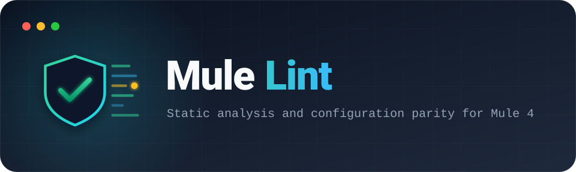
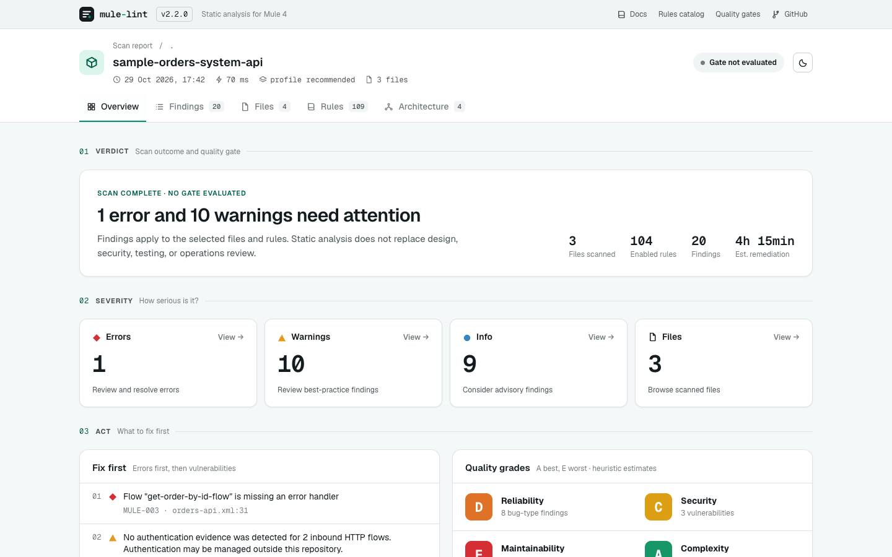
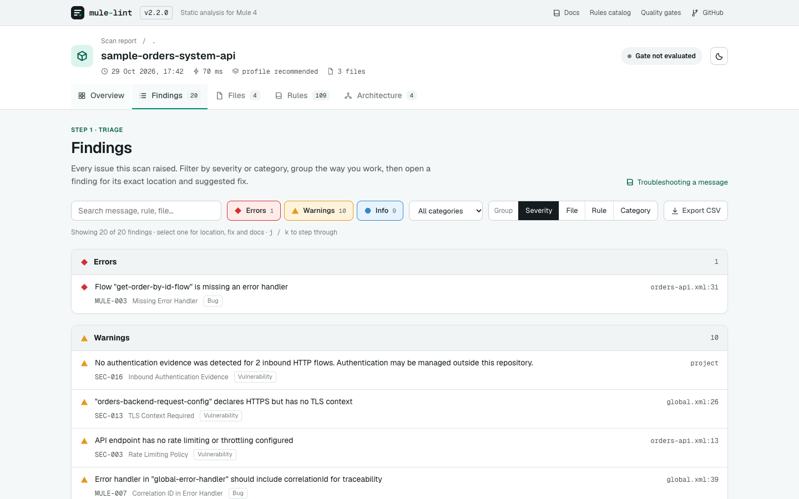

<p align="center">
  
</p>

<p align="center">
  <a href="https://www.npmjs.com/package/@sfdxy/mule-lint"></a>
  <a href="https://github.com/Avinava/mule-lint/actions"></a>
  <a href="https://github.com/Avinava/mule-lint/blob/master/LICENSE"></a>
</p>

<p align="center"><strong>Find Mule 4 problems before deployment: locally, in CI, or with an AI coding agent.</strong></p>

mule-lint scans Mule XML, DataWeave, YAML properties, and project structure. It needs no Anypoint credentials and does not connect to your MuleSoft environments. You need Node.js to run the tool, but you do not need to know JavaScript or Node development.

## Tell your AI agent

**Codex / Claude Code / GitHub Copilot / Gemini / Cursor:**

```text
Fetch and follow https://raw.githubusercontent.com/Avinava/mule-lint/master/docs/agent-setup.md
to set up or update mule-lint in this Mule repository. Detect the agent host and existing
configuration, run a read-only baseline scan, preview any proposed changes, preserve customized
files, and do not modify Mule source or commit unless I approve it.
```

That is enough for the agent to check Node.js, run the pinned CLI, explain the result, and offer only
the MCP, shared policy, or CI integration you need. Prefer the manual first run below when you want
to perform the setup yourself.

## First run

1. Install [Node.js 20 or newer](https://nodejs.org/en/download).
2. Open a terminal in the root of a Mule project, the directory containing `pom.xml`.
3. Run:

```bash
npm install -g @sfdxy/mule-lint
mule-lint . --profile recommended
```

Example summary:

```text
Summary:
  Errors:    1
  Warnings:  10
  Infos:     9
```

Start with errors, then warnings. Info findings are advisory. See the [5-minute guide](docs/getting-started.md) if `node`, `npm`, or `mule-lint` is unfamiliar.

## Useful commands

```bash
# Scan the current Mule project
mule-lint . --profile recommended

# Create an interactive report
mule-lint . --profile recommended --format html --output mule-lint-report.html

# Fail CI when errors or warnings exist
mule-lint . --profile recommended --fail-on-warning

# Validate RAML or OpenAPI
mule-lint api validate ./src/main/resources/api

# Format Mule XML (writes changes)
mule-lint format ./src/main/mule
```

Linting is read-only. The `format` command is the only command above that changes source files; use `format --check` for a read-only preview.

## Explore the HTML report

```bash
mule-lint . --profile recommended --format html --output mule-lint-report.html
```

This writes `mule-lint-report.html` in the current directory. Open it locally to review
Overview, Findings, Files, Rules, and Architecture. Search and group findings, open a
finding for its location and suggested fix, or export the filtered results as CSV.
The report embeds its assets and works offline, with light and dark themes.

**Overview — scan outcome, severity, priorities, and quality grades**



**Findings — severity filters, grouping, and complete finding details**



Screenshots use the [sample project](examples/sample-orders-system-api). Generated reports
can contain local paths and source details; review them before sharing. See the
[HTML report guide](docs/output-formats.md#html) for details. The redesigned interface is
included in this source tree; screenshots may differ from the latest published npm release.

## What a finding means

```text
src/main/mule/orders-api.xml
  31:5  error  Flow "get-order-by-id-flow" is missing an error handler (MULE-003)
```

- `src/main/mule/orders-api.xml` is the file.
- `31:5` is line and column.
- `error` is the severity.
- `MULE-003` is the stable rule ID; look it up in the [rules catalog](docs/best-practices/rules-catalog.md).

The [sample project](examples/sample-orders-system-api) produces the documentation examples and is safe to experiment with.

## Choose an output

| Format         | Command option                         | Best for                      |
| -------------- | -------------------------------------- | ----------------------------- |
| Terminal table | `--format table`                       | A developer fixing a project  |
| HTML           | `--format html --output report.html`   | Exploring and sharing results |
| SARIF          | `--format sarif --output report.sarif` | Pull-request annotations      |
| Report JSON    | `--format report-json`                 | Versioned automation contract |
| JSON           | `--format json`                        | Legacy flat finding arrays    |
| CSV            | `--format csv --output report.csv`     | Spreadsheet review            |
| Markdown       | `--format markdown`                    | PR comments, job summaries    |
| GitHub         | `--format github`                      | Inline Actions annotations    |
| JUnit XML      | `--format junit --output junit.xml`    | Generic CI test reports       |

See [output formats](docs/output-formats.md) for real examples, exit codes, and `--baseline` for reporting only new issues.

## What's new in 2.2

Five configuration parity checks catch what otherwise fails at build, deploy, or startup:

- **Unresolved placeholders** (`CFG-004`): a `${key}` no loaded properties file defines, a key
  missing from one `${mule.env}` environment file, or a key read both with and without `secure::`.
- **Namespace without dependency** (`PROJ-003`): a connector used in Mule XML but missing from
  `pom.xml`.
- **Undefined error types** (`ERR-005`): an unknown `MULE:` type, an error namespace of a connector
  the project does not use, or a custom type caught but never raised.
- **MUnit version parity** (`TEST-002`): plugin, runner, and tools on one version, and 3.1.0 or
  later on Java 17.
- **Sensitive connector loggers** (`LOG-007`): `log4j2.xml` categories that write credentials or
  session data, set to DEBUG or TRACE.

Findings name keys, types, and files, never values.

## What's new in 2.1

- **Both secret models are supported.** A credential can be an encrypted file value referenced as
  `${secure::key}`, or a platform secure property referenced as `${key}` and listed in
  `mule-artifact.json` `secureProperties`. `SEC-007` no longer asks you to change a platform secure
  property to `secure::`, and `SEC-017`, `SEC-018`, and `SEC-019` catch the mismatches between the two.
- **Salesforce connector checks:** Replay listeners that lose events (`SF-003`), Basic
  Authentication above API v64.0 (`SF-004`), and Replay listeners without `primaryNodeOnly`
  (`SF-005`).
- **Deployment and logging checks:** declared Java versions the minimum runtime cannot run
  (`OPS-005`) and connector debug logging committed in `log4j2.xml` (`LOG-006`).

Each rule is documented in the [rules catalog](https://avinava.github.io/mule-lint/best-practices/rules-catalog/)
(MCP: `mule-lint://docs/rules-catalog`); the [changelog](CHANGELOG.md) lists upgrade notes.

## Documentation

- [Getting started](docs/getting-started.md)
- [Common recipes](docs/recipes.md)
- [Troubleshooting](docs/troubleshooting.md)
- [CLI reference](docs/cli-reference.md)
- [Profiles and team rollout](docs/profiles.md)
- [Configuration](docs/configuration.md)
- [MuleSoft practices handbook](docs/best-practices/mulesoft-best-practices.md)
- [MCP setup for coding agents](docs/mcp-design.md)
- [Ecosystem](docs/ecosystem.md): how mule-lint fits with [mule-build](https://avinava.github.io/mule-build/),
  [anypoint-connect](https://avinava.github.io/anypoint-connect/), and [mule-skills](https://avinava.github.io/mule-skills/)
- [Contributor guide](CONTRIBUTING.md)

The searchable site is at <https://avinava.github.io/mule-lint/>.

## CI example

Pin the package version so local and CI scans use the same rules:

```yaml
- name: Scan Mule project
  run: npx -y @sfdxy/mule-lint@2.2.0 . --profile recommended --fail-on-warning
```

For GitHub annotations, generate SARIF and upload it as shown in [CI/CD integration](docs/best-practices/ci-cd.md).

## AI coding agents

mule-lint includes a local MCP server with tools for full-project analysis, snippet validation, rule explanations, XML formatting, and API contract validation:

```bash
npx -y @sfdxy/mule-lint@2.2.0 mcp
```

It uses standard input/output and needs no credentials. Host-specific setup is in the [MCP guide](docs/mcp-design.md).

## Development

```bash
npm ci
npm run build
npm test
npm run check
```

Contributions are welcome. Read [CONTRIBUTING.md](CONTRIBUTING.md) before changing public behavior, rule metadata, or docs.

## License

[MIT](LICENSE) © 2024–2026 Avi
